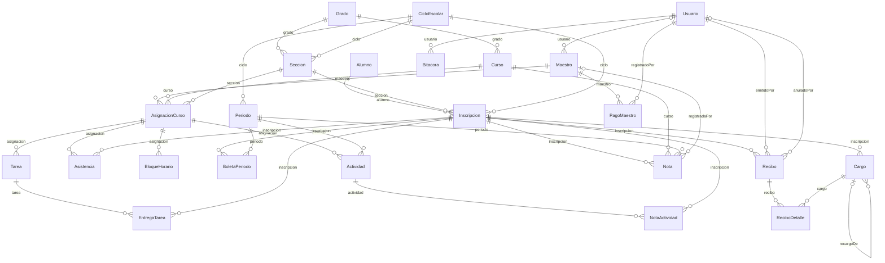
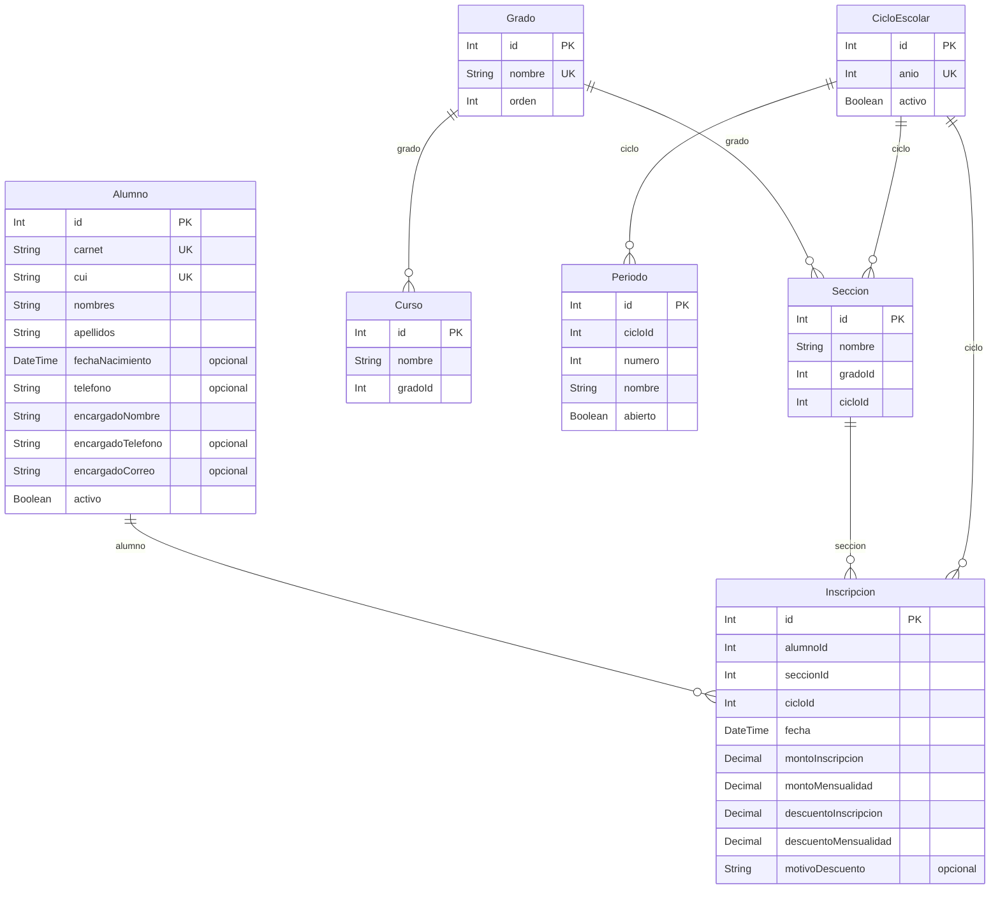
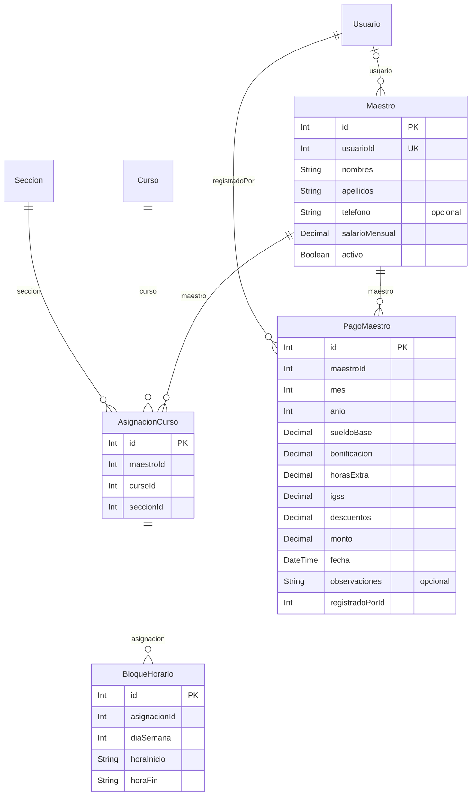
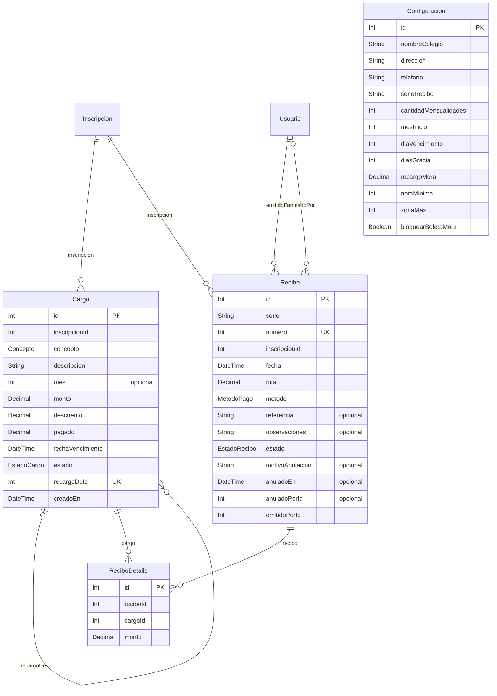
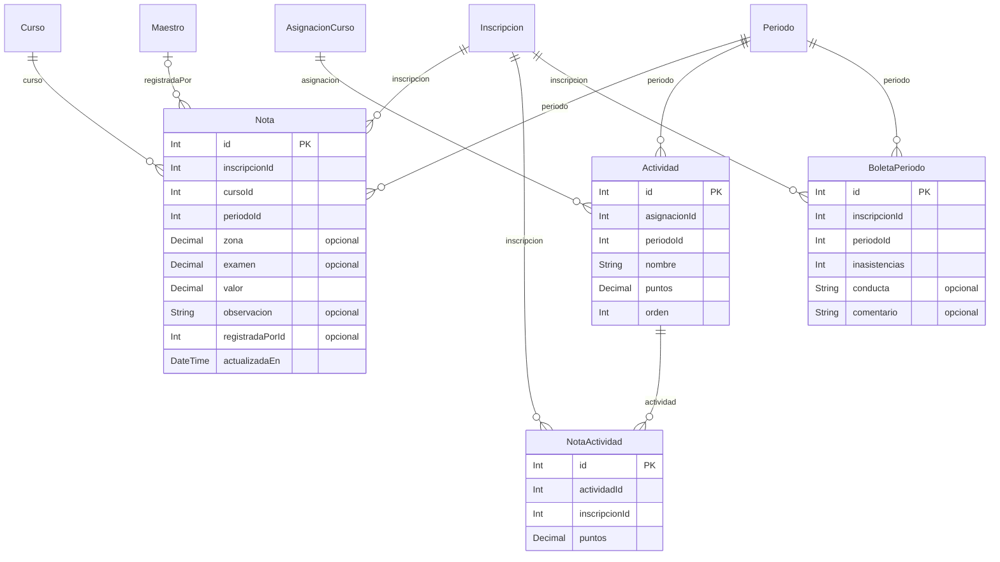
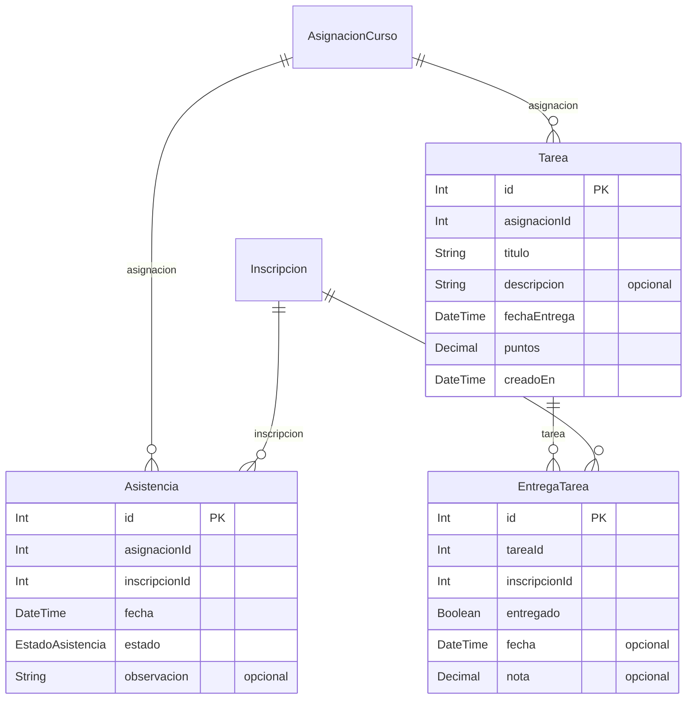
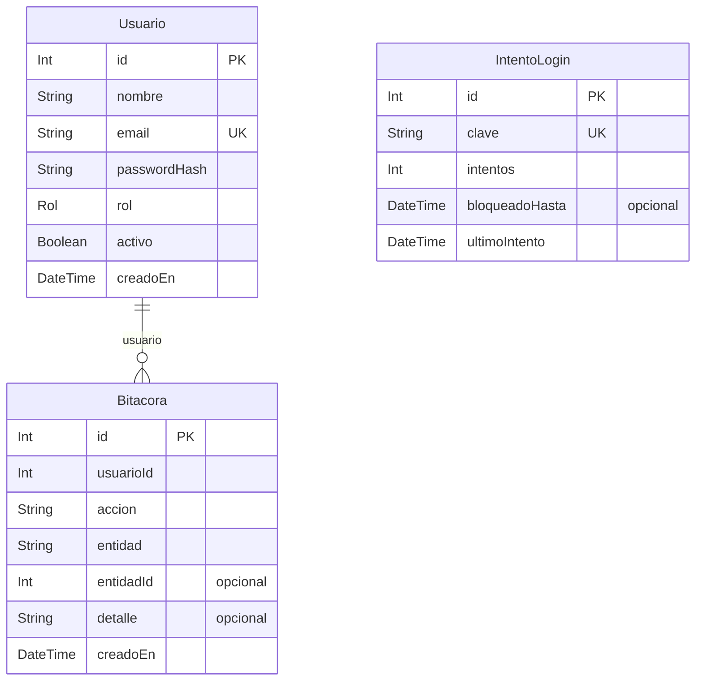

# Diagrama Entidad-Relacion

Sistema Colegio Nuevo Horizonte. **25 tablas y 6 enumeraciones.**

Este documento se genera a partir de `prisma/schema.prisma`, que es la definicion
real de la base de datos. Si el esquema cambia, hay que regenerarlo para que no mienta.

GitHub dibuja estos diagramas solo: se ven aqui mismo, sin descargar nada.

---

## Vista general

Las 25 tablas y como se enlazan, sin los campos, para ver la forma completa de un vistazo.



### Las dos cadenas que hay que saber explicar

**La academica.** Un alumno no pertenece a un grado: pertenece a una *inscripcion*,
y esa inscripcion es la que vive en una seccion de un ciclo. Por eso un alumno puede
repetir grado o cambiarse de seccion sin perder su historial.

```
Alumno -> Inscripcion -> Seccion -> Grado
                      -> CicloEscolar
```

**La de cobros.** El cargo es lo que se debe; el recibo es lo que se pago.
Un recibo puede saldar varios cargos a la vez, y ReciboDetalle guarda cuanto
se aplico de cada uno.

```
Inscripcion -> Cargo -> ReciboDetalle <- Recibo
```

---

## Estructura academica

El esqueleto del colegio: el ciclo lectivo, sus grados y secciones, los cursos que se imparten, los periodos de evaluacion, y la inscripcion que ata a un alumno con una seccion de un ciclo.



## Docencia y planilla

El maestro, los cursos y secciones que tiene asignados, su horario semanal y sus pagos de planilla.



## Cobros y pagos

Lo que se le cobra a cada inscripcion y lo que se recibe. Un recibo puede cubrir varios cargos, y esa relacion de muchos a muchos la resuelve ReciboDetalle.



## Evaluacion

Las notas por periodo, desglosadas en actividades de zona, y la boleta que se genera al cerrar cada periodo.



## Asistencia y tareas

El seguimiento diario del alumno: si asistio, y que tareas se le asignaron y entrego.



## Sistema

Lo que no es del negocio sino de la aplicacion: quien entra, que hizo, y el control de intentos fallidos de ingreso.



---

## Como regenerarlo

El diagrama sale del esquema, no se dibuja a mano. Si alguien agrega o cambia una
tabla, este archivo queda desactualizado y hay que volver a generarlo.

La comprobacion rapida de que sigue al dia: contar las tablas del documento y las
del esquema. Tienen que dar el mismo numero.

```powershell
Select-String -Path prisma\schema.prisma -Pattern "^model " | Measure-Object | Select-Object Count
```
